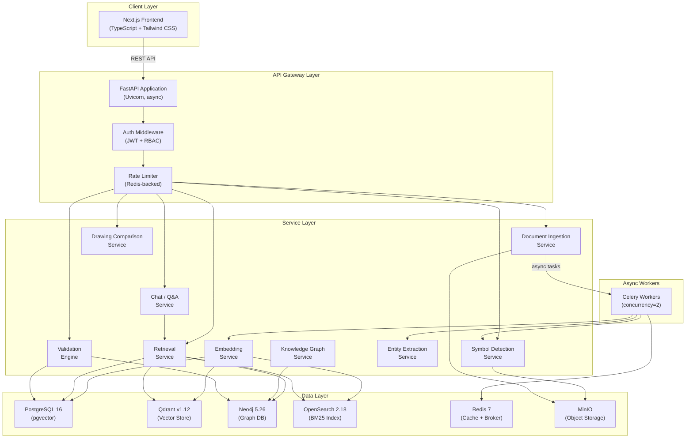
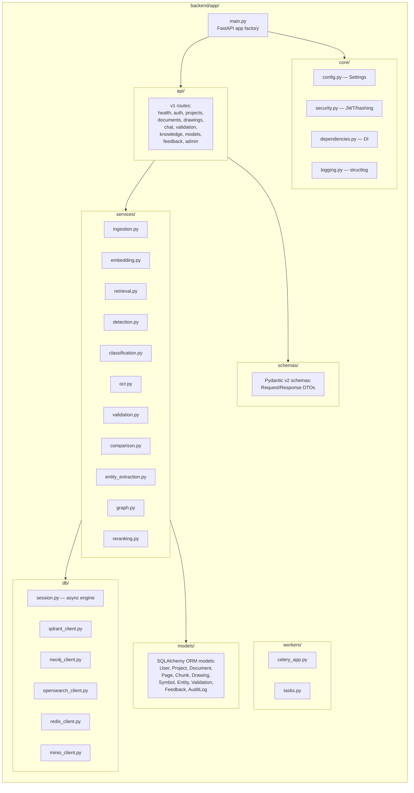
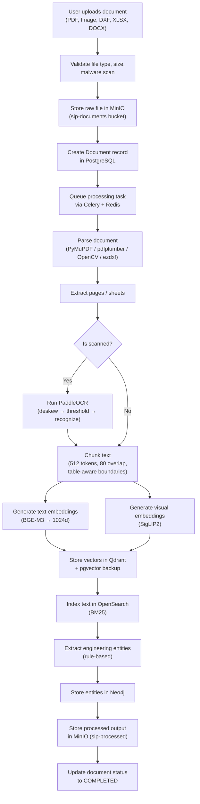
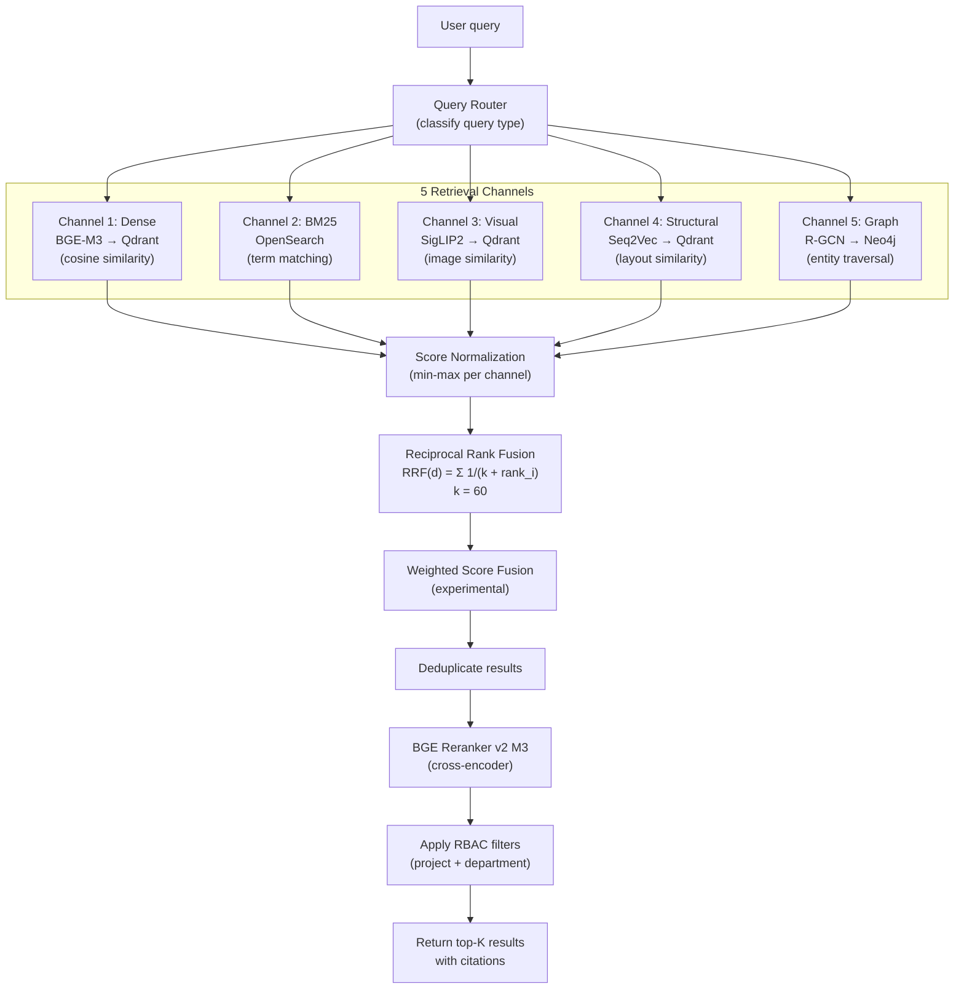
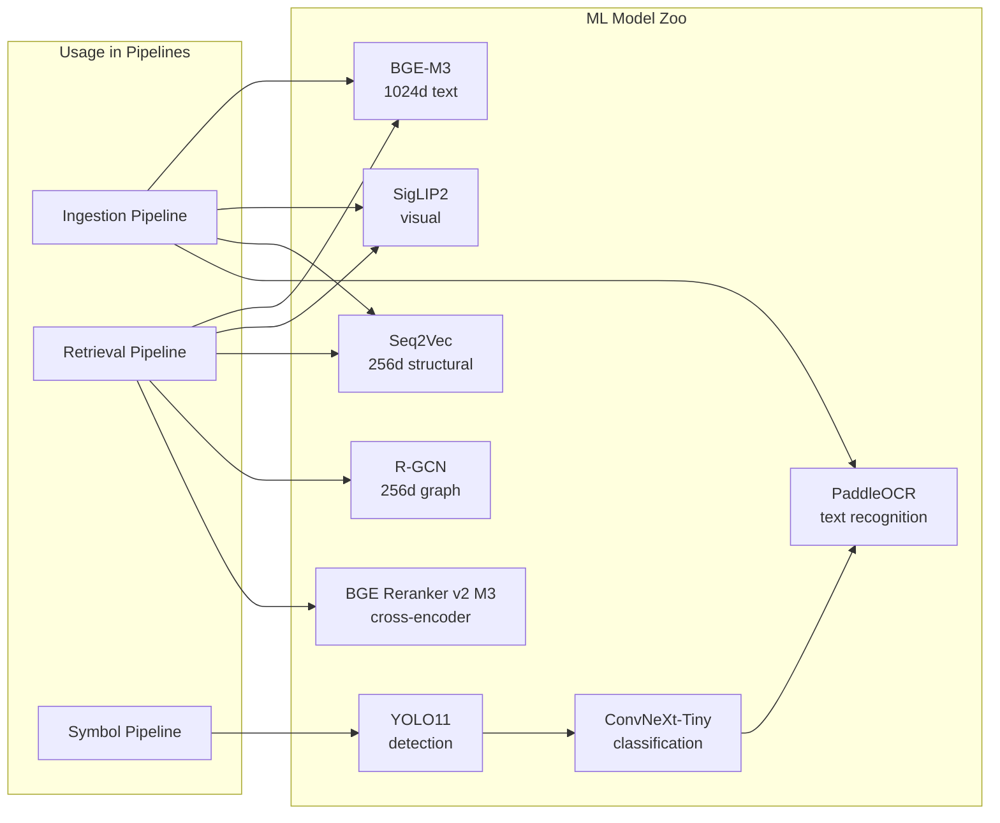
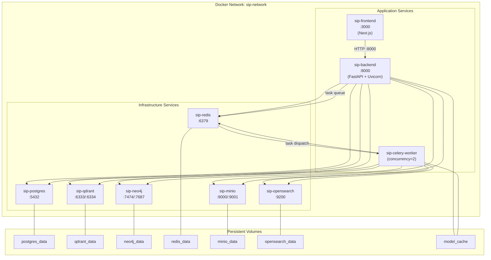

# 01 — System Architecture

## SIP Intelligence Platform — Architecture Documentation

---

## 1. High-Level Architecture

---

## 2. Component Architecture

---

## 3. Data Flow — Document Processing

---

## 4. Retrieval Flow

---

## 5. Service Boundaries

Each service follows the **repository pattern**:

| Service | Responsibility | Databases Used | Async |
|---------|---------------|----------------|-------|
| `IngestionService` | Parse, chunk, and orchestrate document processing | PostgreSQL, MinIO, Redis | ✅ Celery |
| `EmbeddingService` | Generate and store text/visual/structural embeddings | Qdrant, pgvector, OpenSearch | ✅ Celery |
| `RetrievalService` | Execute multi-channel retrieval and fusion | Qdrant, OpenSearch, Neo4j, pgvector | Sync |
| `RerankingService` | Cross-encoder reranking of candidate results | — (in-memory) | Sync |
| `DetectionService` | YOLO11 symbol detection on drawing pages | MinIO, PostgreSQL | ✅ Celery |
| `ClassificationService` | ConvNeXt-Tiny symbol classification of crops | PostgreSQL | Sync |
| `OCRService` | PaddleOCR text extraction from images | — (in-memory) | Sync |
| `EntityExtractionService` | Rule-based extraction of engineering entities | PostgreSQL, Neo4j | ✅ Celery |
| `GraphService` | Neo4j CRUD for knowledge graph queries | Neo4j | Sync |
| `ValidationService` | Run validation rules against drawings/entities | PostgreSQL, Neo4j | Sync |
| `ComparisonService` | Drawing diff — visual overlay and entity delta | MinIO, PostgreSQL | Sync |
| `ChatService` | Orchestrate query → retrieval → formatting | All retrieval stores | Sync |

---

## 6. Model Interactions

---

## 7. Deployment Topology (Docker Compose)

### Port Mapping

| Service | Internal Port | External Port | Purpose |
|---------|--------------|---------------|---------|
| PostgreSQL | 5432 | 5432 | SQL + pgvector |
| Qdrant | 6333 / 6334 | 6333 / 6334 | REST / gRPC |
| Neo4j | 7474 / 7687 | 7474 / 7687 | Browser / Bolt |
| OpenSearch | 9200 | 9200 | REST API |
| Redis | 6379 | 6379 | Cache + broker |
| MinIO | 9000 / 9001 | 9000 / 9001 | API / Console |
| Backend | 8000 | 8000 | FastAPI |
| Frontend | 3000 | 3000 | Next.js |

---

## 8. Technology Decisions

| Decision | Choice | Rationale |
|----------|--------|-----------|
| API framework | FastAPI | Native async, automatic OpenAPI docs, Pydantic validation |
| ORM | SQLAlchemy 2.0 (async) | Mature, supports async via `asyncpg`, Alembic migrations |
| Task queue | Celery + Redis | Battle-tested, supports priorities, retries, rate limiting |
| Vector store | Qdrant + pgvector | Qdrant for speed, pgvector for transactional backup |
| Graph database | Neo4j | Industry standard for property graphs, Cypher query language |
| Full-text search | OpenSearch | BM25 scoring, analyzers, query DSL |
| Object storage | MinIO | S3-compatible, on-premise, supports large files |
| Text embeddings | BGE-M3 | Multilingual, strong retrieval benchmarks, 1024d |
| Visual embeddings | SigLIP2 | Image-text alignment, efficient vision encoder |
| Reranker | BGE Reranker v2 M3 | Cross-encoder accuracy, pairs well with BGE-M3 |
| Detection | YOLO11 | Real-time, single-stage, good for symbol-scale objects |
| Classification | ConvNeXt-Tiny | Efficient CNN, strong transfer learning |
| OCR | PaddleOCR | Open-source, multi-language, runs on CPU |
| Frontend | Next.js 14+ | App Router, SSR/SSG, TypeScript-first |
| Containerisation | Docker Compose | Simple orchestration for single-node prototypes |
| Logging | structlog | Structured JSON logging, request correlation |
