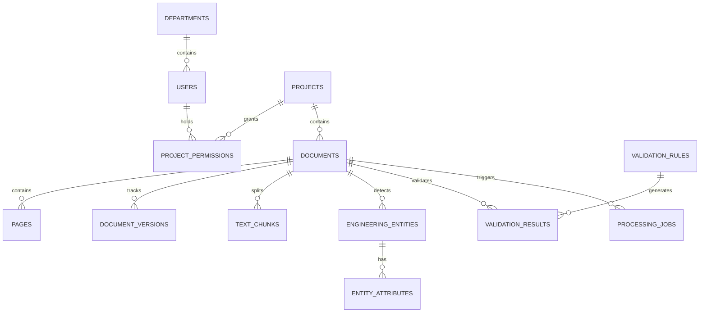

# 02 Database Design & Schemas

## 1. Overview
The SIP Intelligence Platform adopts a polyglot persistence architecture designed to support high-throughput document ingestion, high-dimensional vector search, and complex railway topological graph traversals.

| Store | Purpose | Technology |
|---|---|---|
| Relational / Transactional | Users, Documents, Entities, Rules, Audit | PostgreSQL 16 (with `pgvector` & `pg_trgm`) |
| Vector Database | Multi-representation vector indexes | Qdrant v1.12.5 |
| Knowledge Graph | Signalling topology & interlocking logic | Neo4j 5.26 Community |
| Object Store | Raw drawings, page renders, symbol crops | MinIO / S3-compatible |
| Fast Cache & Queue Broker | Celery task state & retrieval caching | Redis 7 |

---

## 2. PostgreSQL Schema (`sip`)

### Table Definitions

#### `sip.departments`
- `id`: UUID (PK)
- `name`: VARCHAR(255) UNIQUE NOT NULL
- `description`: TEXT
- `is_active`: BOOLEAN DEFAULT TRUE
- `created_at`, `updated_at`: TIMESTAMPTZ

#### `sip.users`
- `id`: UUID (PK)
- `email`: VARCHAR(320) UNIQUE NOT NULL INDEX
- `full_name`: VARCHAR(255) NOT NULL
- `hashed_password`: VARCHAR(255) NOT NULL
- `role`: ENUM ('ADMIN', 'ENGINEER', 'VIEWER', 'MANAGER')
- `department_id`: UUID FK -> `sip.departments.id`
- `is_active`: BOOLEAN DEFAULT TRUE
- `last_login`: TIMESTAMPTZ
- `created_at`, `updated_at`: TIMESTAMPTZ

#### `sip.projects`
- `id`: UUID (PK)
- `name`: VARCHAR(255) NOT NULL
- `description`: TEXT
- `department_id`: UUID FK
- `status`: ENUM ('ACTIVE', 'ARCHIVED', 'SUSPENDED')
- `created_by`: UUID FK -> `sip.users.id`
- `created_at`, `updated_at`: TIMESTAMPTZ

#### `sip.documents`
- `id`: UUID (PK)
- `project_id`: UUID FK NOT NULL
- `filename`: VARCHAR(512) NOT NULL
- `original_filename`: VARCHAR(512) NOT NULL
- `file_type`: ENUM ('PDF', 'PNG', 'JPG', 'DWG', 'DXF', 'XLSX', 'CSV', 'DOCX')
- `file_size`: BIGINT NOT NULL
- `checksum_sha256`: VARCHAR(64) INDEX NOT NULL
- `storage_path`: VARCHAR(1024) NOT NULL
- `status`: ENUM ('UPLOADED', 'QUEUED', 'PROCESSING', 'PARTIALLY_PROCESSED', 'COMPLETED', 'FAILED', 'AWAITING_REVIEW')
- `uploaded_by`: UUID FK -> `sip.users.id`
- `error_message`: TEXT
- `retry_count`: INT DEFAULT 0
- `version`: INT DEFAULT 1

#### `sip.pages`
- `id`: UUID (PK)
- `document_id`: UUID FK -> `sip.documents.id`
- `page_number`: INT NOT NULL
- `width`, `height`: FLOAT
- `dpi`: INT
- `text_content`: TEXT
- `has_images`, `has_tables`: BOOLEAN
- `render_path`: VARCHAR(1024)
- `ocr_text`: TEXT
- `ocr_confidence`: FLOAT

#### `sip.engineering_entities`
- `id`: UUID (PK)
- `document_id`: UUID FK NOT NULL
- `page_id`: UUID FK
- `entity_type`: VARCHAR(64) NOT NULL INDEX
- `label`: VARCHAR(255)
- `x`, `y`, `width`, `height`: FLOAT NOT NULL
- `confidence`: FLOAT
- `detection_model`: VARCHAR(255)
- `classification_model`: VARCHAR(255)
- `verified_by`: UUID FK
- `verified_at`: TIMESTAMPTZ
- `attributes_json`: JSONB
- `source_coordinates`: JSONB

---

## 3. Qdrant Vector Collections

| Collection Name | Dimension | Metric | Payload Schema |
|---|---|---|---|
| `sip_text_embeddings` | 1024 | Cosine | `document_id`, `project_id`, `page_number`, `chunk_index`, `text` |
| `sip_visual_embeddings` | Dynamic (768/1152) | Cosine | `document_id`, `page_number`, `crop_path`, `entity_type` |
| `sip_structural_embeddings` | 256 | Cosine | `drawing_id`, `region_id`, `sequence_length`, `entities` |
| `sip_entity_embeddings` | 256 | Cosine | `entity_id`, `entity_type`, `label`, `drawing_id` |

---

## 4. Neo4j Knowledge Graph Schema

### Node Labels
- `(:Drawing {id, name, revision, project_id})`
- `(:Signal {id, label, aspect, type, chainage})`
- `(:Track {id, name, gauge, electrification})`
- `(:Point {id, label, point_type, normal_route, reverse_route})`
- `(:TrackCircuit {id, label, track_id, detection_type})`
- `(:LevelCrossing {id, gate_no, interlocking_type})`
- `(:KavachTag {id, tag_id, chainage, tag_type})`

### Relationship Types
- `(:Drawing)-[:CONTAINS]->(:Signal|Point|Track|TrackCircuit)`
- `(:Signal)-[:LOCATED_ON]->(:Track)`
- `(:Signal)-[:PROTECTS]->(:Point|TrackCircuit)`
- `(:Point)-[:CONNECTED_TO]->(:Track)`
- `(:TrackCircuit)-[:DETECTS]->(:Track)`

