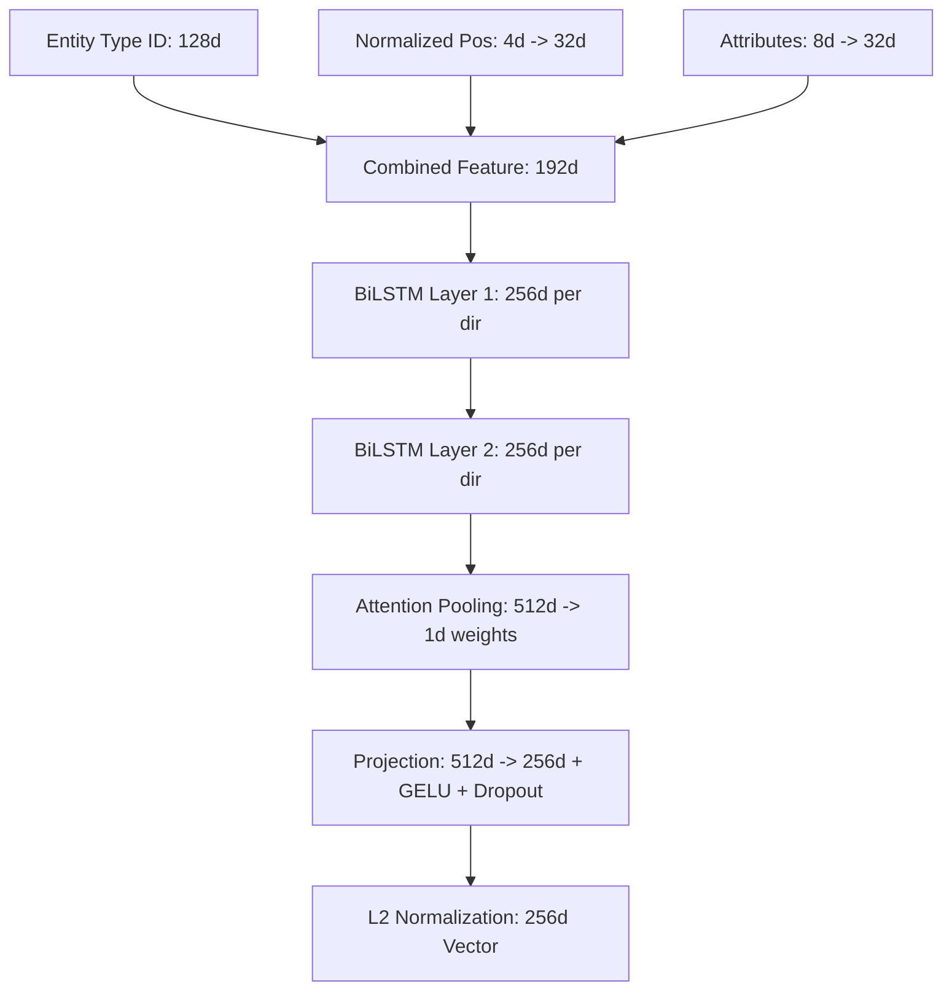

# 03 Machine Learning Architecture

## 1. Overview & Model Inventory

The SIP Intelligence Platform utilizes a multimodal model suite optimized for local inference on private infrastructure (including 4GB–16GB edge GPU setups and CPU fallbacks).

| Model Component | Base Architecture | Input | Output Dim | Task | Current Status |
|---|---|---|---|---|---|
| **Text Embedding** | `BAAI/bge-m3` | Text chunks (≤8192 tokens) | 1024 | Dense text retrieval | Operational |
| **Visual Embedding** | `google/siglip2-base-patch16-224` | Drawing crops / rendered pages | 768 / 1152 | Cross-modal text-to-image | Operational |
| **Symbol Detector** | YOLO11n (`ultralytics`) | Drawing sheets (640x640) | BBoxes + Conf | Symbol region detection | Pretrained baseline |
| **Fine-Grained Classifier** | ConvNeXt-Tiny (`timm`) | Symbol crops (224x224) | 56 classes | Technical symbol classification | Baseline / Pending training data |
| **Structural Seq2Vec** | 2-layer BiLSTM + Attention | Ordered entity sequence | 256 | Topological sequence vectors | Implemented (Experimental) |
| **Graph Relational GCN** | R-GCN (`torch_geometric`) | Multi-relational graph | 256 | Knowledge graph embeddings | Implemented (Experimental) |
| **Neural Reranker** | `BAAI/bge-reranker-v2-m3` | Query + Candidate text pairs | 1 (Score) | High-precision cross-encoding | Operational |

---

## 2. Structural Sequence-to-Vector (Seq2Vec) Model

### Purpose
To encode sequential engineering entities along railway tracks (signals, points, track circuits, Kavach RFID tags) into a fixed-size 256-dimensional structural vector.

### Layer Architecture

### Loss Formulation
$$L = L_{\text{SupCon}} + \lambda \cdot L_{\text{classification}}$$
Where $\lambda = 0.2$, combining Supervised Contrastive learning across similar station topologies with multi-class classification.

---

## 3. Relational Graph Convolutional Network (R-GCN)

### Purpose
Learns unified topological embeddings over railway knowledge graphs directly from Neo4j exported subgraphs.

### Mathematical Formulation
For node $i$ at layer $l+1$:
$$h_i^{(l+1)} = \sigma \left( W_0^{(l)} h_i^{(l)} + \sum_{r \in \mathcal{R}} \sum_{j \in \mathcal{N}_i^r} \frac{1}{c_{i,r}} W_r^{(l)} h_j^{(l)} \right)$$

---

## 4. Hardware Sizing & VRAM Constraints
- **GPU Deployment**: RTX 3050 (4GB VRAM) / RTX 4090 / A100.
- For 4GB VRAM target:
  - Batch sizes: `bge-m3` batch_size = 8, `siglip2` batch_size = 4.
  - FP16 inference enabled where supported.
  - CPU offload available transparently in configuration.

