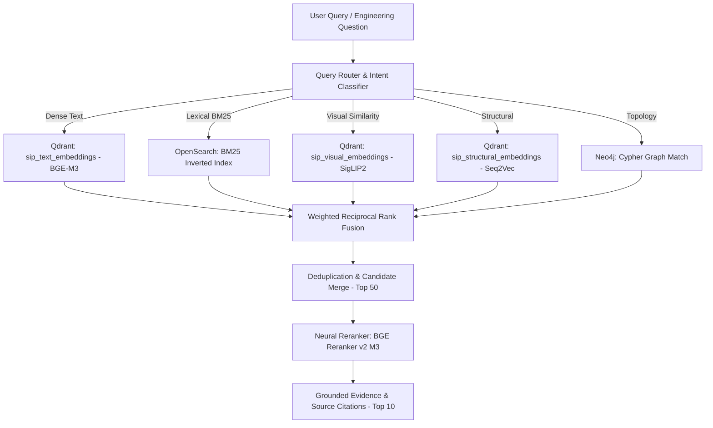

# 04 Embedding and Hybrid Retrieval Engine

## 1. Multi-Channel Retrieval Architecture

---

## 2. Fusion Strategy: Reciprocal Rank Fusion (RRF)

To fuse heterogeneous retrieval scores across vector distances, BM25 TF-IDF scores, and graph depths without calibration drift, the platform implements Weighted Reciprocal Rank Fusion:

$$\text{RRF\_Score}(d) = \sum_{m \in \mathcal{M}} \frac{w_m}{k + \text{rank}_m(d)}$$

Where:
- $k = 60$ (standard smoothing constant)
- $w_m$ is the query-type specific channel weight
- $\text{rank}_m(d)$ is the 1-based rank of document chunk $d$ in retrieval channel $m$.

---

## 3. Query-Type Specific Weight Profiles

| Query Profile | Dense Text ($w_1$) | BM25 ($w_2$) | Visual ($w_3$) | Structural ($w_4$) | Graph ($w_5$) |
|---|---|---|---|---|---|
| **Standards & Rules** | 0.40 | 0.35 | 0.00 | 0.05 | 0.20 |
| **Symbol Identification** | 0.10 | 0.10 | 0.40 | 0.20 | 0.20 |
| **Visual Search** | 0.05 | 0.05 | 0.60 | 0.15 | 0.15 |
| **Engineering Relationships** | 0.15 | 0.10 | 0.10 | 0.25 | 0.40 |
| **Drawing Comparison** | 0.10 | 0.05 | 0.25 | 0.35 | 0.25 |
| **General QA** | 0.30 | 0.20 | 0.20 | 0.15 | 0.15 |

---

## 4. Evaluation Targets & Metrics
- **Recall@5**: Target ≥ 85%
- **Recall@10**: Target ≥ 92%
- **Mean Reciprocal Rank (MRR)**: Target ≥ 0.80
- **nDCG@10**: Target ≥ 0.85
- **End-to-End Latency**: < 450ms (CPU fallback: < 1800ms)

