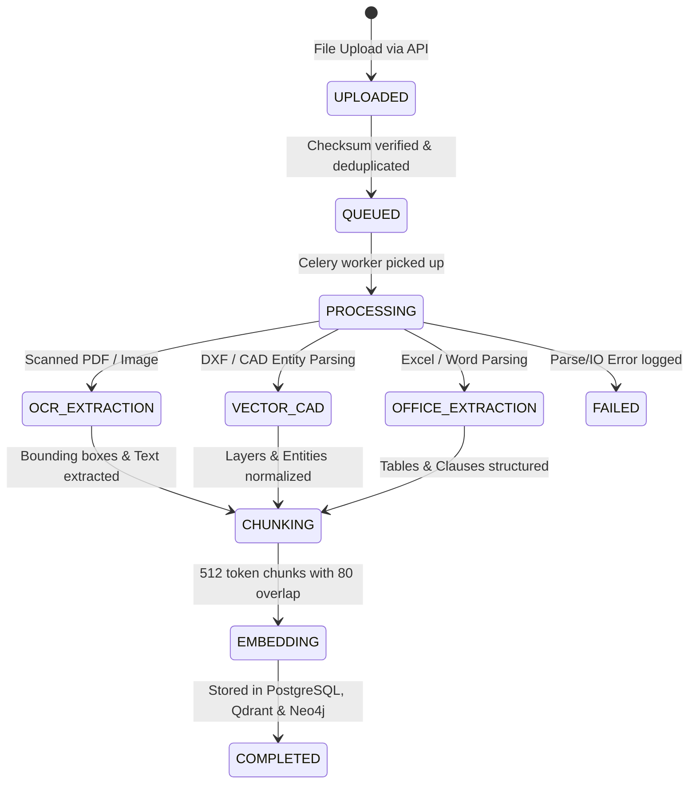

# 05 Document Ingestion Pipeline

## 1. Modular Ingestion Architecture

---

## 2. Ingestion Format Handlers

### Vector PDF Engineering Drawings
- Engine: PyMuPDF (`fitz`) + `pdfplumber`
- Extracts exact text coordinates, drawing scales, line geometries, embedded symbols, and metadata.
- High-resolution rendering at 150–300 DPI for visual inspection and web viewing.

### Scanned PDFs & High-Resolution Scans
- Engine: OpenCV + PaddleOCR
- Preprocessing:
  1. Grayscale conversion and bilateral noise filtering
  2. Deskewing via minimum bounding area rotation
  3. Adaptive Gaussian thresholding
  4. Line segment suppression to improve OCR readability

### CAD Formats (DXF & DWG)
- DXF: Direct parsing via `ezdxf`. Extracts layers, block inserts, attributes, and dimension lines.
- DWG: Architecture includes an external Open Design Alliance (ODA) File Converter adapter interface.

### Office Formats (DOCX, XLSX, CSV)
- Word: `python-docx` extracting heading hierarchy, technical notes, and tables.
- Excel/CSV: `openpyxl` & `pandas` extracting interlocking control charts, track circuit tables, and cable route manifests.

---

## 3. Engineering-Aware Text Chunking
Standard text chunkers break critical signal identifiers across chunk boundaries. The platform’s `ChunkingService` enforces non-breaking regex protections:
- Signal designations (e.g. `101B`, `23AG`, `S12`)
- Clause & Standard references (`IRS-S 36`, `SEM Part I`)
- Chainage notations (`km 142/12`)
- Track circuit boundary tags (`TC 23`, `AC 104`)

