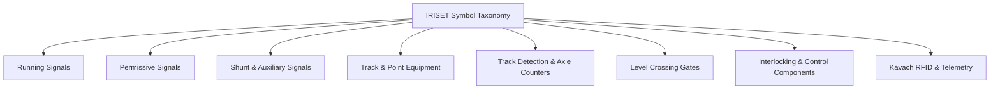
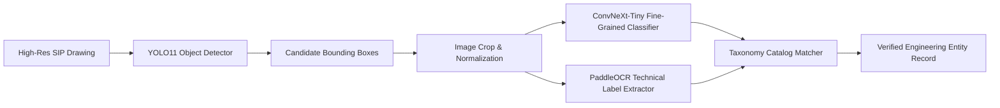

# 06 Engineering Symbol Recognition & Taxonomy

## 1. Symbol Taxonomy Overview

Extracted and verified against the authoritative IRISET (Indian Railways Institute of Signal Engineering and Telecommunications) Drawing Standards (Plates 99 to 105) and railway signalling reference registers.

### Category Breakdown (56 Reference Classes)



### Key Signalling Classes
1. `2A_CL`, `3A_CL`, `4A_CL`: 2/3/4 Aspect Colour Light Signals
2. `HOME`, `STARTER`, `ADV_STARTER`: Running Signal functions
3. `DISTANT`, `INNER_DISTANT`: Permissive approach signals
4. `CALL_ON`: Calling-On subsidiary signal with C-marker
5. `SHUNT`, `PL_SHUNT`: Independent & Position Light Shunt signals
6. `GATE_SIG`: Interlocked Level Crossing protection signals
7. `POINT`, `X_OVER`, `TRAP`: Single switches, crossovers, and derailing traps
8. `TC`, `AC`: DC track circuits and High-Voltage/Multi-Section Axle Counters
9. `KAVACH_TAG`, `RFID_CHAINAGE`: Kavach automatic train protection balises

---

## 2. Detection & Recognition Pipeline



---

## 3. Annotation Dataset Format (YOLO Normalized)
Annotations adhere to standard YOLO format with preserved pixel bounds for auditability:
```text
<class_id> <x_center> <y_center> <width> <height>
```
Where all coordinates are normalized in the range $[0.0, 1.0]$.
Raw bounding boxes $[x_1, y_1, x_2, y_2]$ and DPI are stored alongside in PostgreSQL (`sip.engineering_entities.source_coordinates`).

