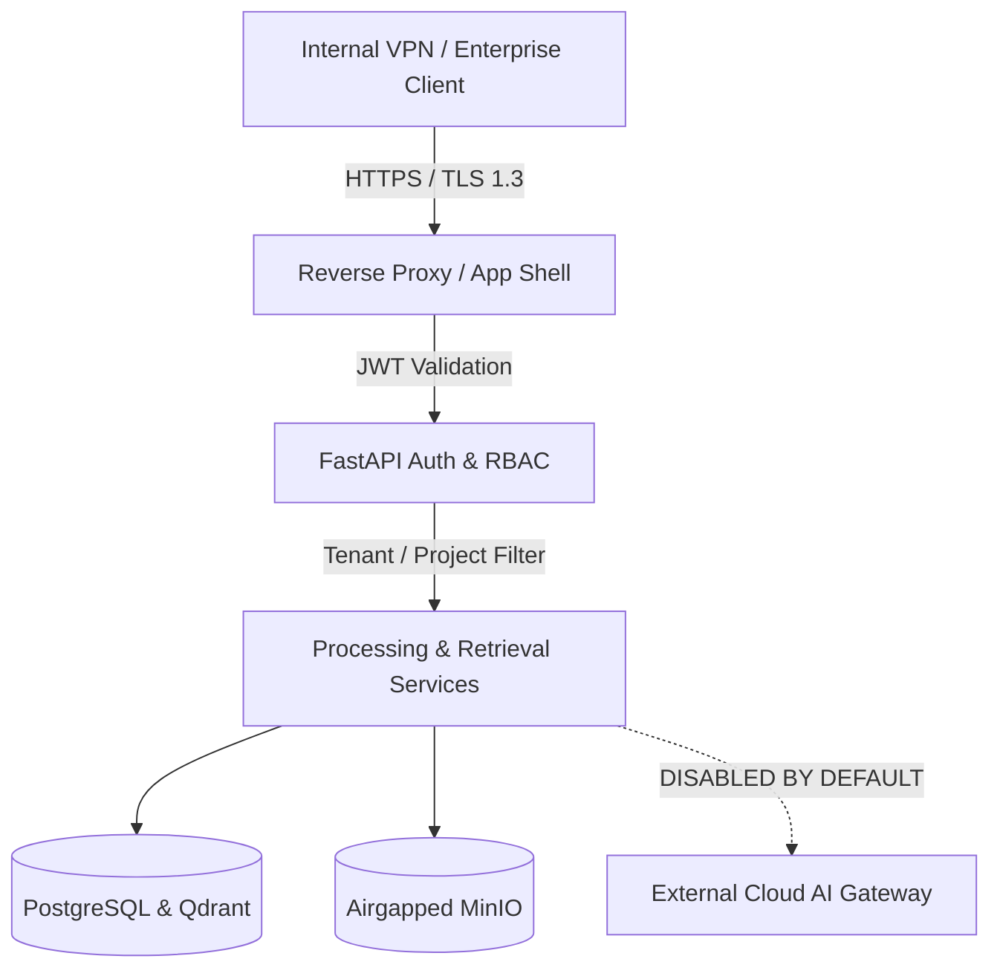

# 08 Security & Access Control

## 1. Threat Model & Boundaries

The SIP Intelligence Platform is engineered for critical railway infrastructure data where drawing leaks or tampering could present severe safety risks.



---

## 2. Airgapped Cloud AI Policy Gateway
- External Cloud AI connections are strictly disabled by default (`CLOUD_AI_ENABLED=false`).
- Outbound document transmission is barred unless explicitly whitelisted with cryptographic hash verification by a designated Safety Admin.
- All embedding generation (BGE-M3, SigLIP2, Seq2Vec, R-GCN) runs exclusively on internal private infrastructure.

---

## 3. Role-Based Access Control (RBAC)

| Role | Permissions |
|---|---|
| **ADMIN** | System configuration, user management, audit review, model registry updates |
| **MANAGER** | Project creation, department assignments, validation report sign-off |
| **ENGINEER** | Document upload, drawing inspection, chat assistant, comparison, rule execution |
| **VIEWER** | Read-only access to approved documents, reports, and knowledge base |

---

## 4. Vector and Document Access Filtering
Every Qdrant vector retrieval request enforces project-level and department-level access filters:
```python
FieldCondition(key="project_id", match=MatchValue(value=project_id))
```
Users cannot retrieve vector chunks or entity records from projects they do not hold explicit permissions for.

