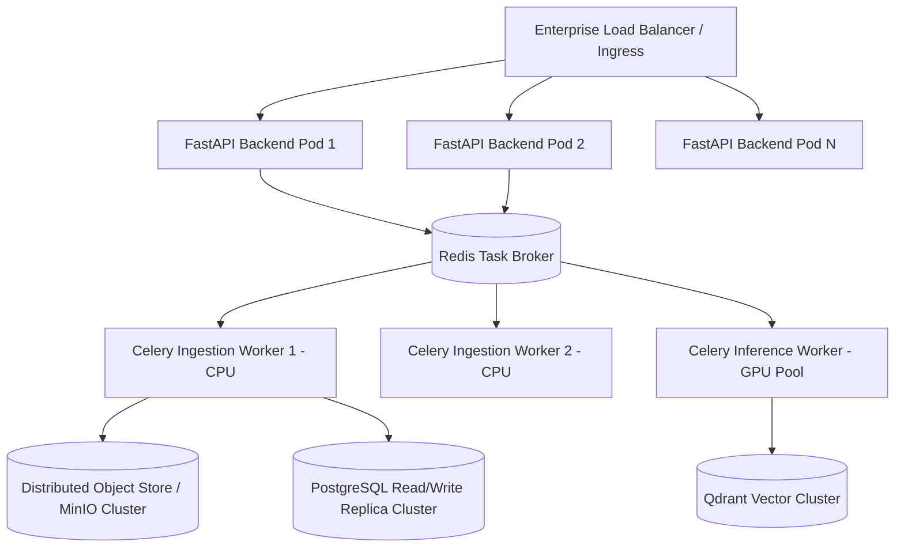

# 12 Enterprise Scalability & Capacity Planning

## 1. Scale Projections & Target Capacity

| Metric | Initial Prototype | Production Phase 1 | Enterprise Scaled |
|---|---|---|---|
| Total Documents | 100 - 1,000 | 10,000 | 100,000 - 1,000,000 |
| SIP Drawings | 50 - 500 | 5,000 | 10,000 - 100,000 |
| Concurrent Engineers | 2 - 5 | 20 - 50 | 250+ |
| Daily Ingestion Volume | 10 - 50 | 100 - 250 | 1,000+ |

---

## 2. Horizontal Scaling Topology

---

## 3. High-Throughput Techniques
- **Database Partitioning**: `sip.text_chunks` and `sip.engineering_entities` partitioned by `project_id`.
- **Worker Segregation**: Separate high-memory OCR workers from GPU-bound vector embedding workers.
- **Asynchronous Execution**: Ingestion, OCR, and validation never block synchronous REST API request threads.

