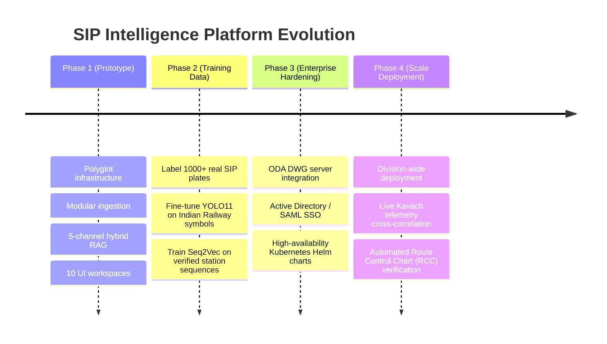

# 14 Implementation Roadmap & Milestones

## 1. Prototype Milestone Status

| Milestone | Deliverable | Status |
|---|---|---|
| **M1: Foundation** | Docker, DBs (Postgres, Qdrant, Neo4j, Redis, MinIO), FastAPI, Next.js | ✅ Completed |
| **M2: Document Ingestion** | PDF, Scanned OCR, DXF, Excel, Word, Chunker, Celery tasks | ✅ Completed |
| **M3: Text RAG** | BGE-M3, BM25, Qdrant store, Hybrid retriever, RRF, BGE Reranker | ✅ Completed |
| **M4: Visual Intelligence** | SigLIP2 visual embedding, YOLO11, ConvNeXt, 56-class catalog | ✅ Completed |
| **M5: Engineering Structure** | Seq2Vec BiLSTM attention, R-GCN PyG, Neo4j graph schemas | ✅ Completed |
| **M6: Comparison & Validation** | Revision diff, deterministic rule engine, finding reports | ✅ Completed |
| **M7: Application Completion** | All 10 Next.js pages, full test suite, technical documentation | ✅ Completed |

---

## 2. Next Production Evolution Phases

